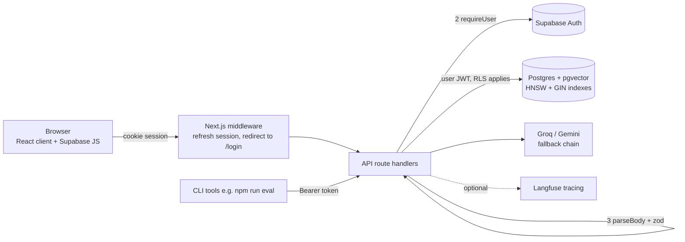

# RAGBase — Architecture & Decision Log

How the app is built, and **why** each choice was made. Every decision has the same shape:
the question, the realistic options, what was chosen and why, a one-line interview answer, and
an **Override** slot for you to disagree in writing. Decisions below were made by default
(Claude's recommendation) — read each one, and if you'd choose differently, write it in the
Override line and say so; the code is small enough to change.

Status legend: ✅ built and verified · 🧪 built, needs your Supabase steps · 📋 planned (not built).

## 1. Target architecture

Request path through a data route, in order — each layer rejects early and cheaply:

| # | Layer | Rejects with | Where |
|---|---|---|---|
| 1 | Same-origin check + per-IP rate limit | 403 / 429 | `src/lib/apiGuard.ts` |
| 2 | Authentication (cookie session or Bearer) | 401 | `src/lib/auth.ts` |
| 3 | Body size cap, JSON parse, schema validation | 413 / 400 | `src/lib/api/http.ts`, `schemas.ts` |
| 4 | Row Level Security in the database | empty result / RLS error | `supabase/migrations/005_auth_tenancy.sql` |

Layer 4 is the one that matters most: even if layers 2–3 had a bug, a user's queries physically
cannot return another user's rows.

Contracts: every route's request schema lives in `src/lib/api/schemas.ts`; every error response is
`{ error: string, code: string, ...extra }` (`apiError()` in `src/lib/api/http.ts`).

## 2. Build stages

| Stage | Scope | Status |
|---|---|---|
| 0 | Contracts, size caps, error format, test runner, CI | ✅ |
| 1 | Auth (Supabase), tenancy, RLS | 🧪 code done; needs migration 005 + dashboard steps |
| 2 | HNSW index, indexed hybrid search, migrations | 🧪 code done; needs migration 006 |
| 3 | Redis rate limiting + caching | 📋 |
| 4 | Background ingestion | 📋 |
| 5 | Connection security (headers, CSP, CORS, cookie flags) | 📋 |
| 6 | Observability (structured logs, Sentry, health) | 📋 |
| 7 | Frontend split, Docker, environments, runbook | 📋 |
| Later | LLM security & governance (prompt injection, PII, output checks) | 📋 |

## 3. Decisions — Stage 0: contracts & safety net

### D0.1 Request validation
- **Options:** hand-written `typeof` checks · zod · valibot/ajv
- **Chosen:** zod (`src/lib/api/schemas.ts`)
- **Why:** one schema is both the runtime check and the TypeScript type (`z.infer`), so the contract
  can't drift from the code. Hand-written checks were already inconsistent across routes (some coerced
  with `String(c)`, some silently defaulted bad `topK`). zod is the de-facto standard in Next.js.
- **Interview answer:** "I treat every request body as untrusted input and validate at the boundary
  with a schema that doubles as the type, instead of casting `req.json()`."
- **Override:** _______________________

### D0.2 Error contract
- **Options:** ad-hoc `{ error }` · RFC 7807 problem+json · `{ error, code }`
- **Chosen:** `{ error: string, code: string, ...extra }`
- **Why:** keeps `data.error` as a string so the existing client works unchanged, while `code` gives
  clients and tests a stable value to branch on. Full RFC 7807 would have meant rewriting every client
  error path for little gain at this size. Internal detail (Supabase messages) is only returned outside
  production (`devDetails`) — it used to leak table/column hints to any caller.
- **Interview answer:** "Stable machine-readable codes, human-readable messages, and no internals
  leaked in production."
- **Override:** _______________________

### D0.3 Size limits
- **Chosen:** body cap checked twice (declared `Content-Length`, then actual text length); per-field
  caps in the schemas (`LIMITS`). Ingest 6 MB / 3000 chunks / 4000 chars per chunk; everything else 256 KB.
- **Why:** `Content-Length` can be absent or wrong, so it's only the cheap first check. Limits sit well
  above what the UI produces (chunker targets ~500 chars) but stop a single request from burning
  embedding quota or memory.
- **Override:** _______________________

### D0.4 Test runner & CI
- **Options:** Jest · Vitest · node:test
- **Chosen:** Vitest + GitHub Actions (lint → typecheck → test → build)
- **Why:** Vitest runs TypeScript and the `@/` alias with almost no config and is fast. Tests target
  pure logic and the security-relevant seams (validators, rate limiter, auth gate, search mappers) —
  not the LLM, which is covered by `npm run eval`. Evals stay manual: they cost free-tier tokens, so
  they are not a CI gate yet.
- **Interview answer:** "Unit tests for deterministic code in CI; a separate LLM-judge eval for quality,
  because model output can't be asserted exactly and costs money to run."
- **Override:** _______________________

## 4. Decisions — Stage 1: auth & tenancy

### D1.1 Auth provider
- **Options:** Supabase Auth · NextAuth/Auth.js · Clerk
- **Chosen:** Supabase Auth
- **Why:** the data already lives in Supabase, and Supabase Auth issues the JWT that Postgres RLS reads
  via `auth.uid()` — so identity and data access share one source of truth. NextAuth would need its own
  user table plus custom JWT plumbing to reach RLS; Clerk adds a paid third party.
- **Interview answer:** "The database enforces tenancy from the same token the auth provider issues, so
  there's no gap between 'who is this' and 'what can they read'."
- **Override:** _______________________

### D1.2 Session transport
- **Options:** JWT in localStorage · httpOnly-style cookies via `@supabase/ssr` · server-side session store
- **Chosen:** cookie sessions (`@supabase/ssr`) + `Authorization: Bearer` for CLI clients
- **Why:** cookies work for server-rendered redirects (middleware) and aren't readable by page scripts
  the way localStorage is. Bearer support exists because `npm run eval` has no browser. Both paths end
  in the same user-scoped client.
- **Override:** _______________________

### D1.3 Where tenant isolation is enforced
- **Options:** (a) app code adds `.eq("user_id", …)` using the service-role key · (b) RLS with a
  user-scoped client
- **Chosen:** (b) RLS. The service-role client was **deleted** from `src/`; admin scripts build their own.
- **Why:** with (a), one forgotten `.eq()` is a cross-tenant data leak, and the service key bypasses all
  protection. With (b), the database refuses regardless of app bugs (verified: `supabase/tests/rls_isolation.sql`).
- **Interview answer:** "Defense in depth — the app authenticates, but the database independently refuses
  cross-tenant access, so an app-layer bug can't become a data breach."
- **Override:** _______________________

### D1.4 Denormalize `user_id` onto `chunks`
- **Options:** RLS on chunks via a join to `documents` · store `user_id` on each chunk
- **Chosen:** store it (indexed), and require in the policy that the parent document has the same owner
- **Why:** a join inside an RLS policy runs on every chunk row of every vector search. A plain column
  compare is cheap and index-friendly. The `WITH CHECK` still blocks planting chunks in someone else's
  document (test T2).
- **Override:** _______________________

### D1.5 Anonymous access
- **Options:** open to everyone · login required · login required + guest sign-in
- **Chosen:** login required, plus **"Continue as guest"** (Supabase anonymous sign-ins)
- **Why:** the public demo URL must stay usable for visitors without making the API anonymous. A guest is
  a real `auth.users` row, so RLS and rate limits work identically — no special-case code path.
- **Needs:** enable "Allow anonymous sign-ins" in the dashboard (see §7).
- **Override:** _______________________

## 5. Decisions — Stage 2: database layer

### D2.1 Vector index
- **Options:** none (exact scan) · ivfflat · HNSW
- **Chosen:** HNSW, `vector_l2_ops`, `m=16, ef_construction=64`
- **Why:** ivfflat picks its cluster centres from the rows present when it is built, so building it on an
  empty or tiny table gives poor recall; HNSW works on an empty table and holds recall as data grows, at the cost of more memory/build time — fine at this scale.
  Operator class matches `<->` (L2) used by the queries, otherwise the index would be silently ignored.
- **Verified:** `EXPLAIN` shows `Index Scan using chunks_embedding_hnsw_idx` at 20,000 rows.
- **Override:** _______________________

### D2.2 Hybrid search implementation
- **Options:** keep in-process BM25 over all rows · Postgres full-text + vector fused in SQL · external
  search engine (Elasticsearch/Typesense)
- **Chosen:** SQL function `hybrid_search_chunks`: HNSW top-100 ∪ GIN full-text top-100, fused with RRF (k=60)
- **Why:** the old path downloaded **every chunk's text and a full distance ordering** to the API server on
  every query — cost grew linearly with the corpus. Now only ~200 candidates are touched, using indexes,
  inside the database. An external engine would be one more service to run for a portfolio-scale app.
- **Behaviour change to know about:** the keyword leg is Postgres `ts_rank_cd`, not literal BM25. The
  response field is still called `bm25Score` so the UI contract is unchanged. Retrieval quality may move
  — **re-run `npm run eval -- --mode both` before and after applying migration 006** and compare.
- **Interview answer:** "Hybrid retrieval does two index lookups in the database and fuses them with
  reciprocal rank fusion; nothing scales with total corpus size except index depth."
- **Override:** _______________________

### D2.3 Migrations
- **Options:** paste SQL in the dashboard · Supabase CLI migrations · an ORM migrator
- **Chosen:** keep numbered SQL files in `supabase/migrations/`, written to be **idempotent**; apply with
  the SQL editor now, `supabase db push` later. 005/006 were tested end to end on a scratch Postgres.
- **Why:** 002–004 were repair patches to 001, which is what un-versioned dashboard edits produce. Numbered,
  re-runnable files are the minimum for repeatable environments; adopting the CLI is a Stage 7 task.
- **Override:** _______________________

## 6. Known limitations (be honest about these)

- **HNSW + tenant filter can under-return.** pgvector applies the `user_id` filter *after* the index
  returns its nearest candidates. With many tenants, a mid-sized tenant's query may get fewer than `k`
  rows. Fix when it matters: pgvector ≥ 0.8 `SET hnsw.iterative_scan = relaxed_order` (not hard-coded
  here because it errors on older pgvector), or partition by tenant. Tiny tenants are safe — the planner
  switches to a btree plan (tested with a 1-chunk user next to a 20,000-chunk user).
- **Rate limiter is still in-memory** (per serverless instance). Replaced in Stage 3.
- **Embedding fallback is silent** — a Gemini embedding outage degrades retrieval to near-random while
  returning 200. Made loud in Stage 6.
- **`GET /api/documents` returns every document's full text.** Pagination belongs with the Stage 7 UI split.
- **Not yet verified against your live Supabase project** — see §7. Everything in §1–5 was verified
  by unit tests (54), a production build, and a scratch-Postgres run of the migrations.

## 7. Applying Stages 1–2 to your Supabase project (your steps)

Do these in order. Applying the code before the SQL will break ingest and search.

1. **Back up / decide on existing data.** Existing rows have no owner and become invisible after 005.
   Either keep them (backfill, step 4) or discard them (`delete from public.documents where user_id is null;`).
2. **Dashboard → Authentication:** keep Email enabled; turn on **Allow anonymous sign-ins**; set the
   Site URL to your deployed domain (and add `http://localhost:3000/auth/callback` and
   `<your-domain>/auth/callback` to Redirect URLs). For fast local testing you can disable "Confirm email".
3. **SQL editor:** run `005_auth_tenancy.sql`.
4. **Sign up once** in the app, copy your user id (Authentication → Users), run the two `update … set user_id`
   statements from the BACKFILL section of 005, then **run 005 again** so `NOT NULL` is applied.
5. **SQL editor:** run `006_search_indexes.sql`.
6. **`.env.local`:** `NEXT_PUBLIC_SUPABASE_ANON_KEY` is now **required** (it was optional before). For
   `npm run eval`, also set `EVAL_EMAIL` / `EVAL_PASSWORD` for an account that owns the documents the
   golden dataset asks about.
7. Re-run `npm run eval -- --mode both` and compare with the pre-change results in `evals/results/`.

To re-verify the SQL yourself on a scratch database: `supabase/tests/local_stubs.sql` then
`supabase/tests/rls_isolation.sql` (needs local Postgres + pgvector).
